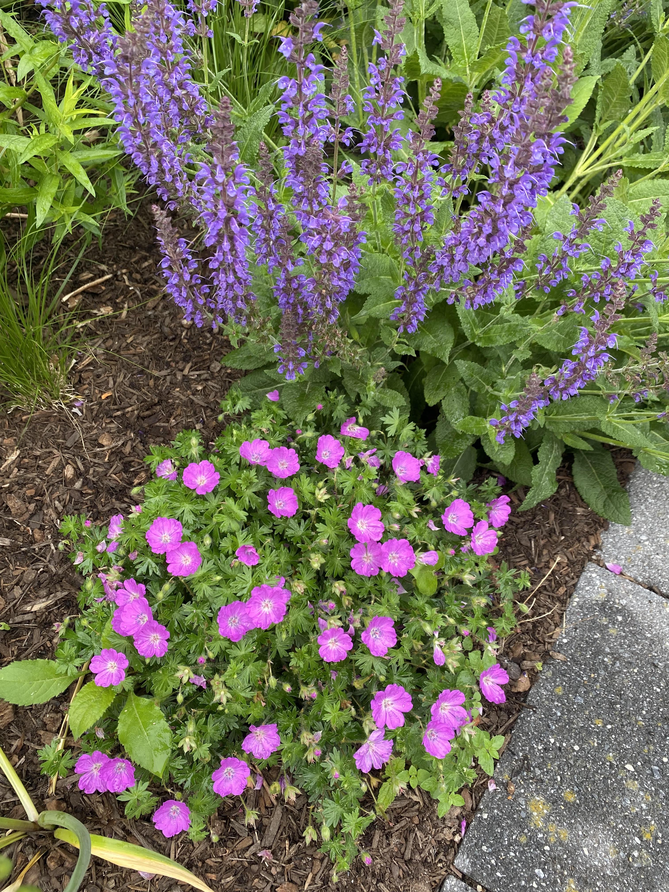
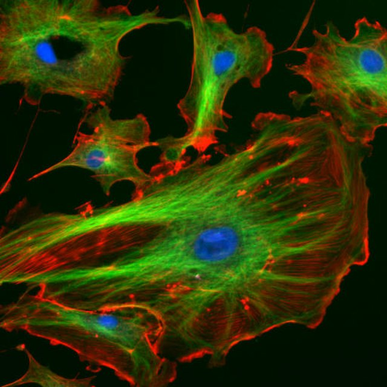
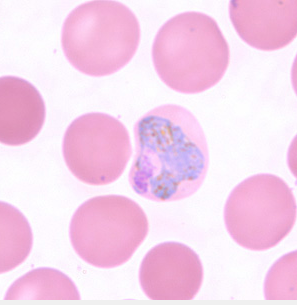
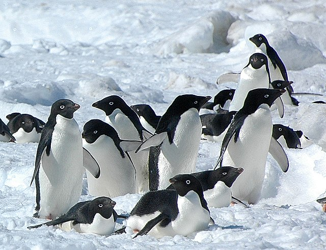
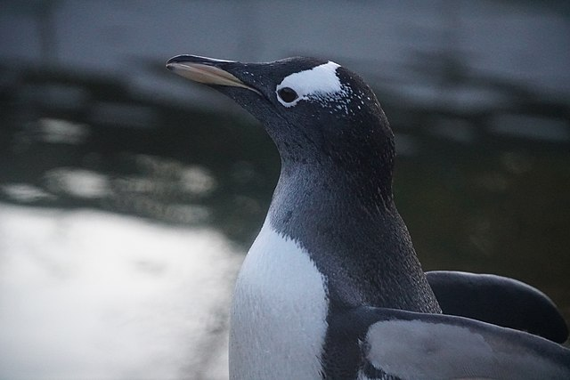
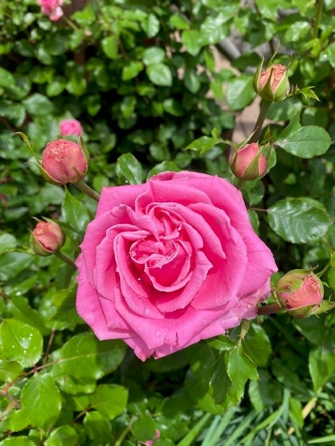
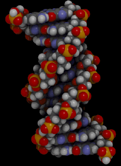

# Biological Sciences: Image Processing

 

**Curriculum Module**

_Created with R2025a. Compatible with R2025a and later releases._

# Information

In this module, we will learn how to **import**, **preprocess**, and **segment biologically relevant images** using MATLAB®. 

## Background

You can use these live scripts as demonstrations in lectures, class activities, or interactive assignments outside class. This module will teach students how to apply image processing methods to biologically relevant data. We will explore image data storage and image segmentation with plant images and then count the number of red blood cells. 

The instructions inside the live scripts will guide you through the exercises and activities. Get started with each live script by running it one section at a time. To stop running the script or a section midway (for example, when an animation is in progress), use the  Stop button in the **RUN** section of the **Live Editor** tab in the MATLAB Toolstrip.

# MATLAB Compatibility

These plain\-text live scripts require MATLAB R2025a or newer. For MATLAB R2024b or older, download the [legacy MLX version](https://github.com/MathWorks-Teaching-Resources/Biosciences-Statistical-Methods/releases/tag/mlx).

## Contact Us

Contact the [MathWorks Educator Content Development Team](mailto:onlineteaching@mathworks.com) if you would like to request assistance, provide feedback, or if you have a question.

# Prerequisites

Make sure you're familiar with the basics of using MATLAB by going through the [MATLAB Onramp](https://matlabacademy.mathworks.com/details/matlab-onramp/gettingstarted) before continuing. You'll need to utilize the [Image Processing Toolbox](https://www.mathworks.com/help/images/) for this module. You may want to consider going through the [Image Processing Onramp](https://matlabacademy.mathworks.com/details/image-processing-onramp/imageprocessing) for further practice.

## Getting Started

### Accessing the Module

### **On MATLAB® Online**™:

Use the  link to download the module. You will be prompted to log in or create a MathWorks account. The project will be loaded, and you will see an app with several navigation options to get you started.

### **On Desktop:**

Download or clone this repository. Open MATLAB, navigate to the folder containing these scripts and double\-click on [BiosciencesImageProcessing.prj](<matlab: openProject("BiosciencesImageProcessing.prj")>). It will add the appropriate files to your MATLAB path and open an app that asks you where you would like to start.

Ensure you have all the required products ([listed below](#H_E850B4FF)) installed. If you need to include a product, add it using the Add\-On Explorer. To install an add\-on, go to the **Home** tab and select   **Add-Ons** > **Get Add-Ons**. 

## Products

MATLAB® is used throughout. Tools from the Image Processing Toolbox™ are used frequently as well.

# Scripts

## [Plant image segmentation](https://matlab.mathworks.com/open/github/v1?repo=MathWorks-Teaching-Resources/Biosciences-Image-Processing&project=BiosciencesImageProcessing.prj&file=Scripts/S1PlantImageSegmentation.m)
||||
| :-- | :-- | :-- |
|     | **In this script, students will...**   $\bullet$ import,  manipulate, and segment a plant image in MATLAB, and learn how images are stored    | **Academic disciplines**   $\bullet$ Biology     |

## [Cell counting](Scripts/S2CellCounting.m)
||||
| :-- | :-- | :-- |
|     | **In this script, students will...**   $\bullet$ segment images by shape and count the number of cells on a microscope slide image of red blood cells    | **Academic disciplines**   $\bullet$ Biology     |

## [Problem set](Scripts/S3ProblemSet.m)
||||
| :-- | :-- | :-- |
|     | **In this script, students will...**   $\bullet$ count the number of healthy cells in an image    | **Academic disciplines**   $\bullet$ Biology     |

# Instructor Resources

[Instructor guides](InstructorResources/InstructorResources.m) contain paired solutions and student\-distribution tools.

# License

The license for this module is available in the [LICENSE.md](https://github.com/MathWorks-Teaching-Resources/Biosciences-Working-With-Data/blob/release/LICENSE.md).

# Related Courseware Modules

| **Courseware**    |  | **Location**     |
| :-- | :-- | :-- |
| [Biosciences: Working With Data](https://www.mathworks.com/matlabcentral/fileexchange/181586-biosciences-working-with-data)     |     | **Available on:**          [GitHub](https://github.com/MathWorks-Teaching-Resources/Biosciences-Working-With-Data)      |
| [Biosciences: Statistical Methods](https://www.mathworks.com/matlabcentral/fileexchange/163691-biosciences-statistical-methods)     |     | **Available on:**          [GitHub](https://github.com/MathWorks-Teaching-Resources/Biosciences-Statistical-Methods)      |
| [Biosciences: Machine Learning](https://www.mathworks.com/matlabcentral/fileexchange/163696-machine-learning-for-biosciences)     |      | **Available on:**          [GitHub](https://github.com/MathWorks-Teaching-Resources/Biosciences-Machine-Learning)      |
| [Biosciences: Genetics](https://www.mathworks.com/matlabcentral/fileexchange/163706-biosciences-genetics)     |      | **Available on:**          [GitHub](https://github.com/MathWorks-Teaching-Resources/Biosciences-Genetics)      |

Or feel free to explore our other [modular courseware content](https://www.mathworks.com/matlabcentral/fileexchange/?q=tag%3A%22courseware+module%22&sort=downloads_desc_30d).

# Educator Resources
- [Educator Page](https://www.mathworks.com/academia/educators.html)
- [Instructor Resources](InstructorResources/Documentation/README.md)

# Contribute 

Looking for more? Find an issue? Have a suggestion? Please contact the [MathWorks Educator Content Development Team](mailto:onlineteaching@mathworks.com). If you want to contribute directly to this project, you can find information about how to do so in the [CONTRIBUTING.md](./CONTRIBUTING.md) page.

# Help us Improve

[Share your feedback](<matlab: ShareFeedback>) to help us improve this module.

*© Copyright 2023\-2026 The MathWorks, Inc.*
